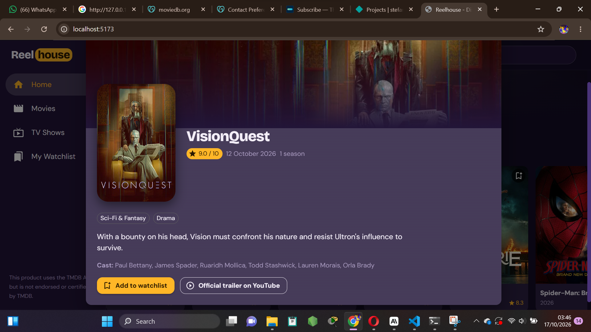

# Reelhouse

A responsive movie and TV discovery web application inspired by MovieBox. Users can browse trending and popular titles, search, filter by genre, read details and keep a personal watchlist.

Built for the Web and Mobile Application Development practical assignment "Movie Discovery Web Application".

- Live site: _ reelhouse-sepia.vercel.app
- Repository: _ https://github.com/jonathansstefane3/reelhouse_

## Screenshots_

| Homepage | Details view |
| --- | --- |
|  |  |

## Technologies

- React 18 (JavaScript / JSX), created with Vite
- Material UI (AppBar, Drawer, Card, Dialog, TextField, Chip, Skeleton, Alert and more)
- React Router v6 for navigation
- React Hooks: `useState`, `useEffect`, `useMemo`, `useCallback`, `useContext`
- Fetch API for network requests
- Netlify (hosting and a serverless function)

## API used

**TMDB (The Movie Database)**, https://www.themoviedb.org/documentation/api

Titles, posters, backdrops, release dates, ratings, genres, descriptions, runtime, cast and trailer links all come from TMDB. Nothing is hardcoded. Missing values (no poster, no description, no rating, unknown date) are handled with fallbacks.

> This product uses the TMDB API but is not endorsed or certified by TMDB.

## Features

| Requirement | Where |
| --- | --- |
| Top bar with name and search field | `components/Layout.jsx`, `components/SearchBar.jsx` |
| Sidebar: Home, Movies, TV Shows, My Watchlist | `components/Layout.jsx` |
| Three or more content sections | `pages/HomePage.jsx` (Trending, Popular movies, Action movies, Popular TV shows, Top rated movies) |
| Live API data | `api/tmdb.js`, `hooks/` |
| Search with loading, empty and error states | `pages/SearchPage.jsx`, `components/PagedGrid.jsx`, `components/StateMessage.jsx` |
| Details dialog (title, poster, overview, date, rating, genre) | `components/DetailsDialog.jsx` |
| Movies page, TV Shows page, genre filter | `pages/BrowsePage.jsx`, `components/GenreFilter.jsx` |
| Watchlist saved in localStorage | `context/WatchlistContext.jsx`, `pages/WatchlistPage.jsx` |
| Responsive layout (permanent sidebar on desktop, menu drawer on mobile, fluid poster grid) | `components/Layout.jsx`, `components/MovieGrid.jsx` |
| Optional extras | "Load more" pagination and official trailer links |

## Project structure

```
src/
  api/tmdb.js              fetch wrapper and image URL helpers
  hooks/                   useFetch, useMediaList, usePagedList
  context/                 WatchlistContext (localStorage), DetailsContext (dialog)
  components/              Layout, SearchBar, Hero, ContentRow, MovieCard, MovieGrid, PagedGrid,
                           GenreFilter, DetailsDialog, StateMessage
  pages/                   HomePage, BrowsePage (Movies and TV), SearchPage, WatchlistPage, NotFoundPage
  utils/format.js          turns movie and TV records into one shape; date and runtime formatting
netlify/functions/tmdb.mjs secure proxy that adds the API key on the server
vite.config.js             dev-server proxy that adds the API key locally
```

## How the API key stays private

The key is **never** in the React code or in GitHub. The browser calls `/api/tmdb/...` on the same site:

Locally, the Vite dev server (`vite.config.js`) forwards the request to TMDB and adds the key from your `.env` file.


## Run locally

Requires Node.js 18 or newer.

1. Get a free v3 API key from TMDB (Settings, then API).
2. Install dependencies:
   
   npm install
   
3. Copy `.env.example` to `.env` and replace the placeholder:
   
   TMDB_API_KEY=your_tmdb_v3_api_key_here
   
4. Start the app:
   
   npm run dev
   
5. Open the address shown in the terminal .

If you change `.env`, stop the server and run `npm run dev` again
